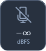
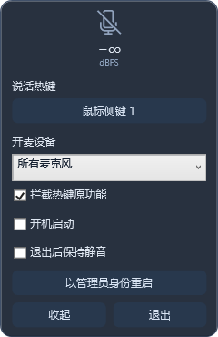

# MicSwitch 中文轻量版

从 [iXab3r/MicSwitch](https://github.com/iXab3r/MicSwitch) fork 而来，针对日常通话大幅重写。**按住热键开麦，松开静音。**

[下载 EXE](https://github.com/Kumiko-kmk/MicSwitch/releases/latest)

- 简体中文；小悬浮窗只显示麦克风图标和实时 dBFS。
- 右键打开设置，点击热键按钮，直接按下键盘按键、组合键、鼠标中键或侧键完成绑定。
- 默认侧键 1；支持所有麦克风、默认通话设备或指定设备。
- 热键、麦克风控制和音量采集各自运行，不让界面绘制或音频初始化阻塞开麦。
- 单个 EXE、免安装、无联网功能，不保存音频。使用 Windows 自带的 .NET Framework；支持 Windows 10/11 x64。

## 使用

下载后将 EXE 放到固定目录再运行。右键悬浮窗 → 设置；双击图标也可展开。设置仅保留热键、开麦设备、热键拦截、开机启动、退出静音和管理员重启。

默认拦截所绑定按键的原功能。绑定组合键时先按修饰键，再按主键；松开主键或修饰键都会静音。Esc 取消绑定；不绑定鼠标左/右键、单独的修饰键以及系统保留组合（例如 Ctrl+Alt+Delete）。

`dBFS` 是数字输入峰值，并非环境声压分贝。灰色图标表示静音，绿色表示开麦，红色表示设备或控制异常。退出后是否保持静音可在设置调整。

## 响应与权限

全局输入 hook 和麦克风控制使用独立线程，进程为 AboveNormal 优先级。普通浏览器、微信取得焦点不会阻止热键；若前台程序以管理员身份运行，可从设置选择“以管理员身份重启”。这不等于凌驾于系统安全桌面、系统保留热键、独占驱动、反作弊或其他输入拦截程序之上。不能承诺任意程序都无法抢占输入。

为避免每次开麦重新初始化音频，采集流在后台保持预热；Windows 可能持续显示麦克风正在被使用。静音由系统输入端点控制，不改变隐私授权，也不写入音频文件。异常退出时，独立保护进程会尝试恢复静音。

## 开发与验证

```powershell
powershell -NoProfile -ExecutionPolicy Bypass -File Sources\MicSwitch.Chinese\build.ps1
```

无需下载 SDK 或初始化上游子模块。源码在 `Sources/MicSwitch.Chinese`，输出在其 `bin` 目录。

[延迟、内存与功能验证记录](docs/chinese/VALIDATION-2.1.md) · [原版说明](README.upstream.md)

原版 Git 历史及代码保留；本版重新实现了中文界面、原生音频控制、热键和异常保护。上游的著作权与授权状态不变，不为其另行添加许可。

## 界面



